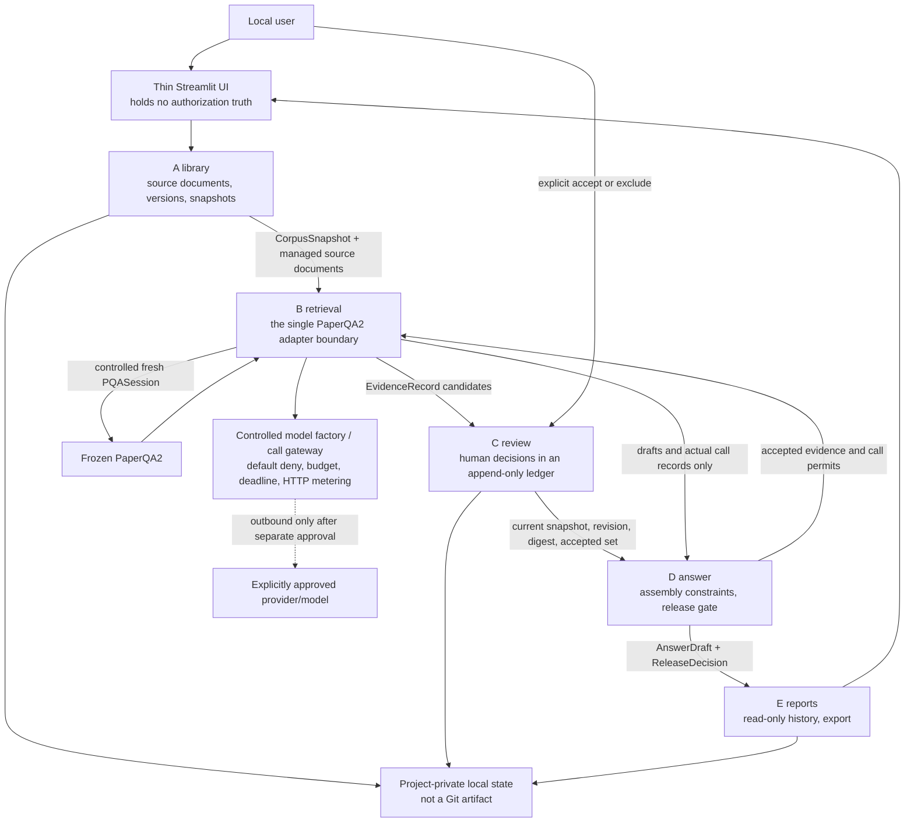

# PaperTrace Architecture Blueprint (single authoritative body)

> Status: **proposed-awaiting-human** (awaiting review by the student themself); this document is a development constraint, not an approval record or an already-running A–E application.
> Pinned upstream: `Future-House/paper-qa@c692d0dfeac4a0296599f7fe21a253a58b7ac12a`. The pinned tag/commit for ordinary feature PRs is protected by the existing `frozen_check`; do not change upstream source/tests/locks. Any necessary compatibility fix must open a separate ADR + human PR, explicitly update the fitness rule/comparison basis and run the affected regressions; verbal approval alone cannot make the current CI pass, and no bypass authorization platform is added.
> This round only initializes documentation, shared contracts, and tooling; the five-module business implementation, real model runs, the course's formal development sessions, and acceptance of remote merge protection must each be completed separately.

## 1. What reading this file can decide

PaperTrace is an **Evidence Review Workbench**: import papers → retrieve candidate evidence → human accept or exclude → generate answers using only accepted evidence → save traceable reports. The topic and the five functional responsibilities are set; this architecture, the safety tests, and each round's execution plan still require human review, and "topic already chosen" must not be treated as "implementation already approved".

Precedence of architectural constraints: course text and explicit authorization → reviewed requirements/invariants → this blueprint and ADRs → shared data contracts → approved plans and tests → module code. On conflict, stop at the planning stage, submit the difference, and do not let the model choose the looser interpretation itself. An unapproved change cannot take effect just by editing one document.

The team's single startup entry point is [`TEAM_START_HERE.md`](TEAM_START_HERE.md). Before starting a module Plan, read only the root `AGENTS.md` / `Prompt.md`, your own task brief, the relevant registry entries and `contracts.py`, and the parts of the integration contract that apply; consult the rest of the architecture material against actual questions, without being required to read the whole repository or follow a fixed checklist indefinitely. This blueprint is a deep design reference, not a prerequisite reading gate for every member. Key decisions include [ADR-001](docs/architecture/adr/001-architecture.md) and the proposed [ADR-002](docs/architecture/adr/002-development-readiness.md).

Page 5 of the original course project requires the single-file architecture artifact to be placed in the architecture directory, while the page 9 tree also lists a root blueprint; this project uses the root file as canonical, and `docs/architecture/architecture-blueprint.md` serves only as a pointer page, to avoid drift between two bodies of text. Whether this submission layout is acceptable is still for the student to confirm with the instructor. [1]

## 2. Drivers, scope, and non-goals

| Architecture driver | Design response | What is not promised |
|---|---|---|
| A real AI feature with a deterministic safety boundary | Reuse PaperQA2 retrieval/summarization/answering; human review and the D release gate hold authoritative adjudication | Initialization contract tests are not a real AI evaluation |
| Each of the five members makes a full functional contribution | A–E each own requirements, design, supervised development, positive and negative tests, and PRs; integration is by interface | No member is limited to writing documents only or running CI only |
| Beginner-maintainable, with controlled coupling | Python 3.14, five modules, thin Streamlit, local file state, a single PaperQA2 adapter boundary | No front-end/back-end split, large database, or microservices |
| Human review cannot be replaced by a model | The append-only `ReviewDecision` ledger is the sole source of the accepted set; D checks freshness and the three-set relationship | Relevance, fluent text, and a model's self-reported success are not human review |
| State can be checked | Immutable sources, snapshots, evidence, and reports; a revision produces a new identity | No claim that SHA256 is a malicious-tampering signature or a proof of scientific truth |
| Cost and privacy | All models disabled by default; after approval every outbound path budgets first, calls second, reconciles third | Do not infer zero requests or free service from upstream `session.cost=0` |

Page 3 of the course project explicitly requires a real AI component and a safety boundary in which AI output is constrained by deterministic code; pages 5–6 and 10 set out the architecture, negative tests, three-layer verification, and gates. Page 25 of the teaching introduction advocates low coupling, clear responsibilities, and low token consumption, but gives no measured performance improvement for this product. [1][2]

**MVP usage boundary**: single machine, single person, single writer; Streamlit is accessed only over local loopback, with no public server deployment and no multi-user support. Locally authorized PDF/TXT files may be imported; for PDF, an explicit pinned PyPDF text parse is preferred, and scanned files or wrong positioning fail explicitly rather than silently switching to paid OCR. Each source file's license is checked item by item, and by default nothing is committed with Git.

**Excluded from the MVP**: import of third-party/downloaded/shared pickle indexes; physical point deletion of vectors; cross-store transactions; cloud collaboration; automatic acquisition of papers from the whole web; automatic determination of scientific facts; multimodal enrichment; autonomous tool loops. Removing a paper only changes a new snapshot; older versions are kept for historical traceability, and no claim is made that vectors were physically erased.

## 3. System boundary and the five modules

In the diagram the gateway is **B-internal infrastructure**, not a sixth business module. Budget rules belong to D's call plan while outbound execution belongs to B; A's ingestion representation, B's retrieval/summarization, and D's answering all pass through this boundary. The diagram has no pre-processing model authorized to bypass it.

| Element / target path | Owns and writable state | Input → output | Must not do |
|---|---|---|---|
| A `src/papertrace/library/` | Import state, managed source documents, logical ID, SHA256 version, immutable snapshot, current snapshot pointer | Local files → `CorpusSnapshot` | Does not decide whether evidence is acceptable; does not import `paperqa` directly |
| B `src/papertrace/retrieval/` | Parsing/retrieval/model adaptation, rebuildable representation cache, call accounting | Snapshot/question → `EvidenceRecord`; accepted evidence/permit → raw answer draft | Does not write the human review ledger, does not make release rulings, gives the model no file/tool permissions |
| C `src/papertrace/review/` | Display source-text/summary differences, comparison, accept/exclude, appending `ReviewDecision` | Evidence + explicit human action → current review projection | Does not allow a model, summary, or imported file to prefill "accepted" |
| D `src/papertrace/answer/` | Selecting the accepted set, context budget, answer state, citation and freshness checks | Snapshot + review projection + question → `AnswerDraft` / `ReleaseDecision` | Does not import `paperqa` directly; does not add retrieval after an abstention; does not change human review |
| E `src/papertrace/reports/` | Immutable research records, historical views, export within licensed scope | D's decisions and evidence bundle → local report | Does not package draft/stale as released, does not overwrite old reports |
| Shared `contracts.py` | The single frozen data definition; no business logic and no outbound calls | Five standard objects | Does not create a second module-private contract of the same name |
| Thin UI such as `app.py` | Sequential calls, form validation, state display, and single-writer lock coordination | User action → module command | `session_state` is not a persistent authorization ledger; does not cache a PQASession reusable across rounds |

The above are **target paths and responsibilities**, not a claim that the directories already contain implementations. Module import direction: UI → A/B/C/D/E; modules → contracts; D → B's public controlled interface; B → paperqa. E consumes only standard data and calls no model. Cross-module reads are provided by interfaces; modules are forbidden to write each other's files directly. Structural tests should verify that `paperqa` imports appear only in B, and that a pure contract import initializes neither upstream nor any model.

## 4. How the pinned source is wired in, and which capabilities already exist

The line numbers below all correspond to the pinned commit and do not reuse line numbers from the old audit draft or a Release. The audit package is an analysis source, not a runtime receipt. [12]

| Baseline fact | Exact source | PaperTrace's delta and limits |
|---|---|---|
| `Docs.aadd` computes MD5; a missing citation can call a model, and doc details can call models and a metadata service | `src/paperqa/docs.py:171–206,224–311`[3] | A uses SHA256 as the team version; B requires a human/file-manifest citation and disables doc details, media, and enrichment; A must not call the default quickstart directly |
| `aadd_texts` / `retrieve_texts` can trigger embedding, and laziness does not equal no outbound call | `docs.py:340–386,437–489`[3] | Ingestion and retrieval embeddings must each pass through the same approval and metering; wrapping only the answer is not enough |
| `aget_evidence` can return summaries, scores, and the original Text, and has partial retries | `docs.py:492–585`; `core.py:233–269,305–378,383–400`[3][6] | B keeps the source text and locator; summary/score are suggestions, not review decisions; internal retries are also subject to budget |
| `Context.id` depends by default on the question and the first 500 characters of the summary, and excludes the source version | `types.py:238–316`[4] | The team evidence ID is derived separately from the immutable source; model extras cannot determine identity or authorization |
| `aquery` builds the model first; empty contexts may by default fetch evidence automatically, and pre/post can make further outbound calls | `docs.py:602–639,694–711`[3] | D checks for an empty accepted set before calling B; B explicitly injects controlled objects, `get_evidence_if_no_contexts=false`, `pre=None`, `post=None` |
| The default serializer applies top-N/cutoff first, then concatenates summaries; it enforces no hard token cap | `settings.py:1179–1250`[5] | D/B use a custom deterministic assembler that records the actual sent set, and do not treat the whole session set as the sent set |
| Unknown citations in the original `raw_answer` may be removed during formatting | `types.py:474–526`[4] | D must check the raw output first; it may not "delete the bad citations and then pass", and it does not substitute a `used_contexts` substring test for structural parsing |
| Current vector deletion is mitigated by tombstones, and old-session evidence is not automatically checked against the snapshot | `docs.py:403–435,476–490,609–647`[3] | Use a new snapshot, a new session, and the freshness release gate; do not use the MVP to claim all vector lifecycles are fixed |
| The `SearchIndex` documents and the `files.zip` mapping both have pickle loaders | `agents/search.py:86–93,242–257`[7] | The MVP accepts no third-party index and does not use its high-level directory index import; choosing the JSON document format also cannot remove the mapping risk |
| The high-level Agent builds the index first, and answering can still be triggered beyond the timeout; reset can clear Docs | `agents/main.py:121–124,155–183`; `agents/env.py:243–272`[8][13] | Disable the high-level autonomous Agent and the fake-agent entry point; a low-level async API with a fixed order is more controllable |

Upstream already provides retrieval, summarization, citation, partial abstention on empty evidence, retries, and token counting. The team's innovation is human authorization, source identity, controlled outbound calls, and the release/history contracts; existing capabilities must not be renamed and then claimed as original.

## 5. The five shared contracts and identity rules

The authoritative field names, enums, and JSON schema are given by `src/papertrace/contracts.py`; the table below specifies semantics and cannot replace that implementation or be used to widen the model for missing fields on your own. All objects are **frozen** and collections use immutable representations; nested objects may not be rewritten in place either. Changing state should create a new object or append an event.

| Contract | Semantics it must carry |
|---|---|
| `CorpusSnapshot` | The immutable value of the paper manifest; `snapshot_id` is the hash of the normalized, sorted manifest, not a timestamp or random session ID. A paper's logical ID means "which paper" and the SHA256 version means "which bytes" |
| `EvidenceRecord` | The combination of snapshot, doc, version, locator, and source text; the ID is derived from a hash of these inputs; summary/score are listed separately as suggestions; **no standalone accepted field** |
| `ReviewDecision` | Can be created only by an explicit human action; appended to C's ledger; the latest valid decision for the same snapshot/evidence forms the projection; with no decision it is `pending`, not accepted by default |
| `AnswerDraft` | Binds the question, this round's snapshot, the review revision/digest, the approved/sent/cited three sets, and the raw draft/status; it denotes a draft only and grants no release authority |
| `ReleaseDecision` | D's deterministic ruling; it may abstain, block, mark stale, or permit release; it is not a model-emitted `approved: true`, nor a certification of scientific fact |

The current AnswerDraft statuses are draft/abstained/failed, and ReleaseDecision is only released/blocked; "stale" in this document is the reason/UI semantics of a blocked decision, and no new enum is pushed into the contract.

Identity computation must use the canonical serialization defined by contracts (encoding, field ordering, set ordering, schema/domain version) and must not concatenate ambiguous strings. The doc version is the SHA256 of the source file bytes; parser/chunker/embedding/prompt versions are recorded separately as a representation fingerprint and cannot be mixed in to replace the source-byte identity. A locator expresses a page or line range plus chunk number that can actually be verified; when only the page range can be verified, show the page range and do not invent character offsets or precise bboxes. PDF chunks already have a page range, see `readers.py:92–143`. [9]

The current SourceLocator accepts only complete page or line ranges plus chunk/parser identifiers; character offset/bbox are a future contract extension and are not claimed as already supported. ReviewDecision projects by `(snapshot_id, question_id, evidence_id)`, and acceptance state cannot be reused across questions.

For the same source text: a change of summary does not change source identity; a change of the source-byte version, locator, or snapshot requires re-deriving the corresponding evidence ID. IDs claimed in a summary, upstream `Context.id`, a model-supplied accepted, and "already accepted" labels in a historical cache all have no authority to change C's ledger.

## 6. Normal sequence and the three hard gates

1. **A ingestion gate**: check path/type/size/license → copy into the project-managed area → verify SHA256 → make the parse success/failure state explicit → create a new snapshot and atomically switch the current pointer. A partially failed batch is not marked complete; external source documents are not changed.
2. **B candidate retrieval**: lock the snapshot and representation fingerprint; embedding/summarization are allowed only with an approved call permit; return the source text, a re-checkable locator, and the suggested summary to C. With no model permit, "model not yet authorized" may be displayed; retrieval results must not be fabricated.
3. **C human review gate**: the UI shows the pinned source text, the source version, and a summary warning. Only an explicit accept/exclude appends a decision; each effective change increments `review_revision` and recomputes `review_digest`; refreshing the UI does not replay approvals.
4. **D pre-generation gate**: read the current snapshot + C projection; with no currently accepted evidence → `abstain` directly, with **zero model factory initialization, zero SDK calls, and zero HTTP attempts**. This branch does not call B's generation entry point and does not let PaperQA2 add retrieval.
5. Only with accepted evidence is context assembled and approved recorded; after budget trimming the sent set is produced, guaranteeing `sent ⊆ approved`. Only the sent accepted source text / its explicitly labeled summary is placed into the **fresh** `PQASession.contexts`; no old session is carried over and no pending/rejected item is placed. Short upstream aliases are mapped one-to-one per round by B, and D validates the full evidence ID; an alias grants no authorization.
6. B explicitly disables automatic evidence fetching, pre/post, metadata/enrichment, and the high-level Agent; the controlled factory is initialized only after approval and budget. Before answering, record the final actual payload token count, sent IDs, request ID, call permit, and deadline; after the outbound call, record every attempt.
7. **D release gate**: check the raw output format and citations → `cited ⊆ sent ⊆ approved`; check the source locator/version → re-read the current snapshot and the review revision/digest; any change means `stale` and no release. A successful non-abstaining answer must also carry traceable citations; whether the semantics actually support it is a separate human/evaluation responsibility.
8. E persists only the decision and evidence bundle as the corresponding state. The release check and the E write must be inside the same single-writer critical section; re-check freshness before writing, to prevent "changed after the check, bypassed before landing on disk". Do not hold the lock while waiting for the model during generation: A/C are allowed to complete operations, but any older generation result is invalidated.
9. Published history always shows "the snapshot/review version at that time"; a change to the current snapshot may append a superseded note/projection view but must not rewrite or delete old reports. Exporting history is not a new release; to become a current new report it must pass D again.

`approved` is the full set of current accepted items derived from C when generation starts; `sent` is the subset that actually appears in the final payload; `cited` is the set parsed from the structured citations of the raw output. If evidence is withdrawn and re-accepted during generation, the old result must still be blocked even if the sets happen to be the same, because the revision has changed. No authorization set is ever restored from a summary, a model self-report, or the UI cache.

## 7. Context and call budget

The detailed algorithm is in [memory-design.md](docs/architecture/memory-design.md). Proposed engineering defaults (**pending student approval, not measured results**): input hard cap **12,000 tokens**, compression/trimming starts at **9,000**, output at most **2,000**. Every call must count its actual system/user/template/tool envelope, and the input plus output reserve must fit the approved model window. Scores/counts are not a token budget.

The layers are, in order: identity → standing constraints → authorization summary → materials → history → restoration state → current question. The authorization summary is produced from the ledger by trusted code, not by an LLM summary; fixed identity/limits/authorization IDs cannot be compressed into a new identity or a new decision. Deduplicate → prioritize → count → deterministic compression → re-inject key constraints → assemble → final count; if it still does not fit, refuse rather than silently exceed the limit.

Citation inference, metadata HTTP, media enrichment, pre/post, and the autonomous Agent are disabled by default; embedding, candidate summaries, answering, and every retry can be enabled only after explicit approval of provider/model, data scope, amount, and count. Factory initialization, SDK attempt, HTTP attempt, successful response, and usage/amount are accounted separately; a missing usage is marked unknown, not 0. Upstream `PQASession.add_tokens:414–433` is after-the-fact counting and cannot alone provide this contract. [4]

## 8. State, permissions, monitoring, and specific failure actions

The sole truth about state is A snapshots, C's append-only human review ledger, and E reports, not Streamlit session_state or pickle. The project-private runtime directory must be Git-excluded, with separate areas for source documents, evidence, logs, and exports; paths, privacy, retention, and recovery are in the state document.

Permissions use default deny: code, data, network, and tools not explicitly allowlisted can be neither read nor written. The authorizations of a development AI role and of an in-product user are two separate boundaries: letting a coding agent write a module does not permit it to create `ReviewDecision`s, read real papers, or run models; see the permission table.

Monitoring uses allowlisted events that carry at least `request_id`, snapshot, review revision/digest, policy/prompt/model/representation identifiers, the approved/sent/cited counts and necessary IDs, decision, reason, and token and attempt counts. Normal logs store no secrets, full paths, source text, full questions, or model-private reasoning; source text is kept only in the controlled evidence store. On an authorization/source anomaly, pause release for this round and keep an isolation record; an empty accepted set leads to abstention; budget/timeout stops new outbound calls; storage corruption is isolated read-only rather than automatically "repaired into passing". Each invariant has its own fallback, see the register.

The events and runtime monitoring above are a **design contract awaiting module implementation**, not proof that monitoring is already deployed this round or that there are zero outbound connections.

## 9. Verification and course gates

- **Structural layer**: contracts frozen/round-trip/invalid input; only B imports upstream; no business module implemented ahead of time; the source baseline unchanged; paths denied by default; all model call sites in the matrix; this blueprint is the single body of text.
- **Regression layer**: keep upstream `tests/`; the team's `test/offline/` and `test/live/` are separate. Every round runs all registered prior suites and states explicitly what is skipped/xfail/missing dependencies; a green light on an offline subset is not called a full regression.
- **Behavioral layer**: fixed cases verify abstention, citation, staleness, and re-injection; a fake model verifies only the deterministic gates; real retrieval/answer quality requires an approved provider/model and a fixed evaluation set, with real receipts retained, and a stub or an old cassette cannot be passed off as a new model evaluation.
- Every feature has at least one negative test, and every INV needs a test that fails when the invariant is deliberately broken. A planned test ID in the matrix does not mean the file is implemented or passing. Page 6 of the course project requires three-layer verification, and page 10 requires six categories of blocking gate plus a security-path ADR + human review. [1]

| Six gate categories | Architecture requirement | What initialization cannot claim as done |
|---|---|---|
| Test pre-approval | Binds the requirement, test content hash, pre-implementation version, and a trusted human review record | An Agent-written approved is not an approval |
| Static/dependency/security/permissions | Lint/type/dependency per commit; a security PR additionally runs contract/safety/API/permission checks | A local document or a single CI file is not remote enforcement |
| Schema | The registry passes the schema, with IDs/fit criteria/traces complete | Passing the schema does not mean the product already meets the requirements |
| Semantic | A prompt/model change triggers the fixed real evaluation and thresholds | Not authorized/not run means blocked, with no skip-as-pass |
| Regression | The full prior suite list and real results | Course requirements are not omitted on your own because live runs are expensive |
| AI-use log | Every code/prompt change is tied to the real tool contribution and human intervention | Sessions, approvals, or member contributions are not fabricated |

All required checks, administrator bypass, and branch protection can be called in effect only after they are actually configured in the team's private repository, read back, and validated with a failing PR. This architecture draft provides no such remote acceptance conclusion.

## 10. Workflow and change policy

Requirement classification → candidate comparison/ADR → interface and negative-test design → **student approves the tests and the execution plan** → OpenCode build → structural/regression/behavioral verification → independent PR review → human merge. On discovering a failure, first preserve the receipt and update the bug/debt plus the requirements/architecture/tests; it is not allowed to pursue green by lowering thresholds, changing fixture answers, or deleting a refusal path.

Security-related changes (review authority, source identity, release gate, budget, permissions, pickle, historical state) require a new or revised ADR, an impact list, negative tests, and approval by the student themself; ordinary details must not be written across module boundaries either. After a requirement change, the governance rules must be synchronized within one sprint (page 6 of the course project); requirements, contracts, architecture, prompt, tests, trace, and AI-use log must be updated together. [1]

Functional ownership A–E is stable in the long term; **process roles such as plan facilitation, test design review, verification supervision, PR reviewer, and integration facilitation may rotate**. This preserves both the single feature claim and the role-rotation requirement on page 4 of the course project, without making any member a permanent management position and without putting personal identities in the documents. [1]

## 11. Items that must be confirmed by the student

- The ADRs, the 12,000/9,000/2,000 engineering defaults, the test plan, and the execution plan are not yet approved; no one may sign on the student's behalf.
- Pages 5 and 20 of the teaching introduction require **OpenCode** as the coding agent, and page 20 emphasizes real human supervision. The current initialization is not a formal OpenCode D5 development record and must not be renamed to pass as one. Its page 6 evaluation-model description does not automatically authorize any current model call. [2]
- Page 2 of the project text ("five annotated transcripts") and page 6 D5 ("one full, raw transcript / from scratch") differ in wording; together with the boundary for reusing PaperQA2, this needs instructor confirmation, and the convenient reading may not be chosen unilaterally. [1]
- Page 7 of the teaching introduction gives only **Week 13 Project Due**, with no exact year-month-day or time-zone deadline; the latest course notice must be checked. Page 23 additionally requires a 10-minute demo, and the ZIP contains neither video nor API key. [2]
- This round's anonymous team material carries no names, student IDs, or accounts; pages 6–7 of the final D6 text do, however, require real student identity, relative contribution, and personal reflection, with formatting requirements such as at most 10,000 words and more than 15 pages at 12pt single spacing. The student adds the real information in the formal submission and confirms the typesetting basis with the instructor, and the anonymous initialization is not treated as a D6-compliant finished product. [1]
- Review the licenses of papers and optional parsers item by item. The main package declares Apache; the PyMuPDF subpackage declares AGPL, and the root license cannot be extended to cover all dependencies or papers. [10][11]

## Sources

[1] urn:sha256:6af742d3cbc0973b056a084ba54ff413a5885b1bb4d6a97b0b08b93f64f2ef7e — CS5351-2026-2027-project.pdf (local original-text extraction, 10 pages)
[2] urn:sha256:16d399f7ca14e0c49dea382cec3893bbee8f589edcaee5131f10fad257d3acb5 — cs5351-2026-2027-introduction.pdf (local original-text extraction, 27 pages)
[3] https://github.com/Future-House/paper-qa/blob/c692d0dfeac4a0296599f7fe21a253a58b7ac12a/src/paperqa/docs.py — pinned baseline src/paperqa/docs.py
[4] https://github.com/Future-House/paper-qa/blob/c692d0dfeac4a0296599f7fe21a253a58b7ac12a/src/paperqa/types.py — pinned baseline src/paperqa/types.py
[5] https://github.com/Future-House/paper-qa/blob/c692d0dfeac4a0296599f7fe21a253a58b7ac12a/src/paperqa/settings.py — pinned baseline src/paperqa/settings.py
[6] https://github.com/Future-House/paper-qa/blob/c692d0dfeac4a0296599f7fe21a253a58b7ac12a/src/paperqa/core.py — pinned baseline src/paperqa/core.py
[7] https://github.com/Future-House/paper-qa/blob/c692d0dfeac4a0296599f7fe21a253a58b7ac12a/src/paperqa/agents/search.py — pinned baseline src/paperqa/agents/search.py
[8] https://github.com/Future-House/paper-qa/blob/c692d0dfeac4a0296599f7fe21a253a58b7ac12a/src/paperqa/agents/main.py — pinned baseline src/paperqa/agents/main.py
[9] https://github.com/Future-House/paper-qa/blob/c692d0dfeac4a0296599f7fe21a253a58b7ac12a/src/paperqa/readers.py — pinned baseline src/paperqa/readers.py
[10] https://github.com/Future-House/paper-qa/blob/c692d0dfeac4a0296599f7fe21a253a58b7ac12a/pyproject.toml — pinned baseline pyproject.toml
[11] https://github.com/Future-House/paper-qa/blob/c692d0dfeac4a0296599f7fe21a253a58b7ac12a/packages/paper-qa-pymupdf/pyproject.toml — pinned baseline PyMuPDF subpackage license declaration
[12] urn:sha256:21f1c516a57e975a284d1d278926fedd9755a6d0036314279663c4074063942a — PaperQA2 audit handover ZIP (only the extracted Markdown was read)
[13] https://github.com/Future-House/paper-qa/blob/c692d0dfeac4a0296599f7fe21a253a58b7ac12a/src/paperqa/agents/env.py — pinned baseline src/paperqa/agents/env.py
