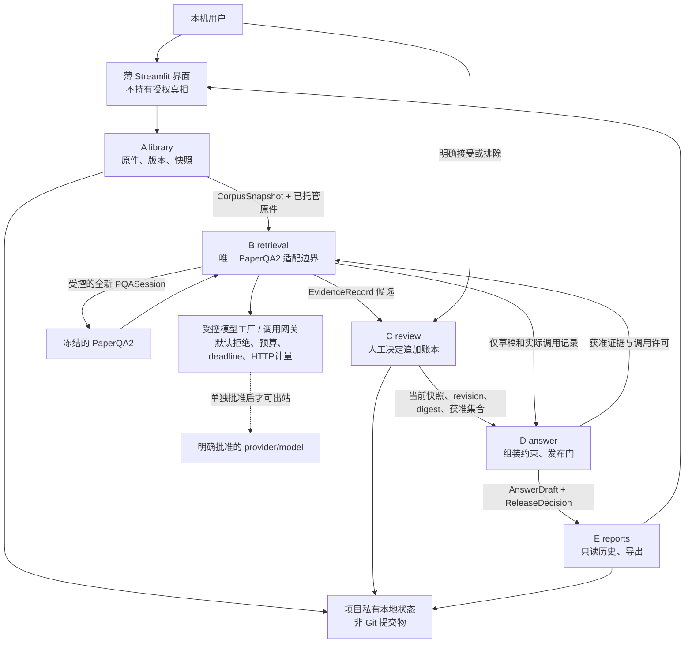

# PaperTrace 架构蓝图（唯一权威正文）

> 状态：**proposed-awaiting-human（等待学生本人审核）**；本文是开发约束，不是批准记录或已运行的 A–E 应用。
> 固定上游：`Future-House/paper-qa@c692d0dfeac4a0296599f7fe21a253a58b7ac12a`。普通功能 PR 的固定 tag/commit 由现有 `frozen_check` 保护，不改上游源码/测试/锁。必要兼容修复须另开 ADR + 人工 PR，明确更新 fitness rule/比较口径并跑受影响回归；仅口头批准不能让当前 CI 通过，不增旁路授权平台。
> 本轮只初始化文档、共享契约与工具；五模块业务实现、真实模型运行、课程正式开发会话及远端合并保护的验收均须分别完成。

## 1. 读这份文件能决定什么

PaperTrace 是 **Evidence Review Workbench（证据审核工作台）**：导入论文 → 检索候选证据 → 人工接受或排除 → 仅用获准证据生成回答 → 保存可追溯报告。选题和五个功能责任已确定；本架构、安全测试与每轮执行计划仍须人审，不能把“已选题”当作“已批准实现”。

架构约束的优先顺序：课程原文与明确授权 → 已审需求/不变量 → 本蓝图与 ADR → 共享数据契约 → 获批计划与测试 → 模块代码。冲突时停在计划阶段，提交差异，不让模型自行选择较宽松的解释。未批准的更改不能只靠改一份文档生效。

团队唯一启动入口是 [`TEAM_START_HERE.md`](TEAM_START_HERE.md)。开始模块 Plan 前只读根 `AGENTS.md` / `Prompt.md`、本人任务书、相关 registry 与 `contracts.py`、集成合同相关部分；其余架构材料按实际问题查，不要求通读全仓库或沿固定清单无限阅读。此蓝图是深度设计参考，不是每个成员的先决阅读闸门。关键决策包括 [ADR-001](docs/architecture/adr/001-architecture.md) 与提案中的 [ADR-002](docs/architecture/adr/002-development-readiness.md)。

课程项目原文第 5 页要求架构单文件产物放在架构目录，第 9 页树又列根蓝图；本工程采用根文件作 canonical，`docs/architecture/architecture-blueprint.md` 仅作指向页，避免两份正文漂移。是否接受这一提交布局仍由学生向教师确认。[1]

## 2. 驱动因素、范围与不做项

| 架构驱动 | 设计响应 | 不承诺的内容 |
|---|---|---|
| 真正的 AI 功能且有确定性安全边界 | 复用 PaperQA2 检索/摘要/回答；人工审核和 D 发布门负责权威裁决 | 初始化契约测试不等于真实 AI 评测 |
| 五人各有完整功能贡献 | A–E 各自负责需求、设计、监督开发、正负测试、PR；按接口集成 | 不把任何成员限定成只写文档或只跑 CI |
| 初学者可维护、控制耦合 | Python 3.14、五模块、薄 Streamlit、本地文件状态、唯一 PaperQA2 适配边界 | 不引入前后端分离、大型数据库或微服务 |
| 人审不能被模型替代 | `ReviewDecision` 追加账本是获准集合的唯一来源；D 检查新鲜度和三集合关系 | 不把相关度、流畅文字、模型自报成功当人审 |
| 状态可核对 | 不可变来源、快照、证据与报告；改版产生新身份 | 不声称 SHA256 是恶意篡改签名或科学真伪证明 |
| 成本与隐私 | 默认禁用所有模型；获准后每条出站路径先预算、再调用、后对账 | 不从上游 `session.cost=0` 推断零请求或免费 |

课程项目第 3 页明确要求真实 AI 组件以及 AI 输出受确定性代码约束的安全边界；第 5–6、10 页规定架构、负测、三层验证和门禁。教学介绍第 25 页提倡低耦合、清晰职责与低 token 消耗，但没有给本产品任何已测性能提升。[1][2]

**MVP 使用边界**：单机、单人、单写者；Streamlit 仅本机回环访问，不部署公网服务器，不接多用户。可导入本地获授权的 PDF/TXT；PDF 首选显式固定 PyPDF 文本解析，遇扫描件/错误定位明确失败，不默默换收费 OCR。原件许可逐件核查，默认不随 Git 提交。

**排除 MVP**：第三方/下载/共享的 pickle 索引导入；物理向量定点删除；跨存储事务；云端协作；全网论文自动获取；自动判定科学事实；多模态 enrichment；自主工具循环。移除文献只改变新快照，旧版本为历史追溯保留，不声称向量已物理擦除。

## 3. 系统边界与五模块

图中网关属于 **B 内部基础设施**，不是第六个业务模块。预算规则归 D 的调用计划、出站执行归 B；A 的入库表示、B 的检索/摘要、D 的回答都通过此边界。图没有授权绕行的预处理模型。

| 元素 / 目标路径 | 负责与可写状态 | 输入 → 输出 | 不得做 |
|---|---|---|---|
| A `src/papertrace/library/` | 导入状态、托管原件、logical ID、SHA256 version、不可变快照、当前快照指针 | 本地文件 → `CorpusSnapshot` | 不决定证据可接受；不直接导入 `paperqa` |
| B `src/papertrace/retrieval/` | 解析/检索/模型适配、可重建表示缓存、调用账目 | 快照/问题 → `EvidenceRecord`；获准证据/许可 → 原始回答草稿 | 不写人审账本，不作发布裁决，不给模型文件/工具权限 |
| C `src/papertrace/review/` | 展示原文/摘要差别、比较、接受/排除、追加 `ReviewDecision` | Evidence + 明确人工动作 → 当前审核投影 | 不允许模型、摘要、导入文件预填“已接受” |
| D `src/papertrace/answer/` | 选获准集合、上下文预算、回答状态、引用与新鲜度校验 | 快照+审核投影+问题 → `AnswerDraft` / `ReleaseDecision` | 不直接导入 `paperqa`；不在拒答后补检索；不改人审 |
| E `src/papertrace/reports/` | 不可变研究记录、历史视图、许可范围内的导出 | D 的决策与证据包 → 本地报告 | 不将 draft/stale 包装成 released，不覆盖旧报告 |
| 共享 `contracts.py` | 唯一冻结数据定义；无业务逻辑与外呼 | 五种标准对象 | 不再造模块私有的同名合同 |
| `app.py` 等薄 UI | 顺序调用、表单校验、状态显示和单写者锁协调 | 用户操作 → 模块命令 | `session_state` 不是持久授权账本；不缓存可跨轮复用的 PQASession |

以上是**目标路径与责任**，不是宣称目录已含实现。模块导入方向：UI → A/B/C/D/E；模块 → contracts；D → B 的公开受控接口；B → paperqa。E 只消费标准数据，不调用模型。跨模块读取由接口提供，禁止相互直接写对方文件。结构测试应验证只有 B 出现 `paperqa` 导入，且纯契约导入不会初始化上游或模型。

## 4. 固定源码如何接入，哪些能力已存在

以下行号均对应固定提交，不套用审计旧稿或 Release 行号。审计包是分析来源，不是运行回执。[12]

| 基线事实 | 确切来源 | PaperTrace 的增量与限制 |
|---|---|---|
| `Docs.aadd` 会算 MD5；缺 citation 可调模型，doc details 可调模型和元数据服务 | `src/paperqa/docs.py:171–206,224–311`[3] | A 用 SHA256 做团队版本；B 必填人工/文件清单 citation，关闭 doc details、媒体与 enrichment；A 不能直接调用默认 quickstart |
| `aadd_texts` / `retrieve_texts` 可触发 embedding，延迟不等于免外呼 | `docs.py:340–386,437–489`[3] | 入库与检索 embedding 各自须经过同一批准和计量，不能只包回答 |
| `aget_evidence` 可返回摘要、score 和原 Text，并有局部重试 | `docs.py:492–585`；`core.py:233–269,305–378,383–400`[3][6] | B 保留原文及 locator；摘要/分数是建议，不是审核决定；内部重试也须受预算 |
| `Context.id` 默认依赖问题与摘要前 500 字符，不含来源版本 | `types.py:238–316`[4] | 团队 evidence ID 另由不可变来源派生；模型 extras 不能决定身份或授权 |
| `aquery` 先构造模型；空 contexts 默认可自动补证，pre/post 可再外呼 | `docs.py:602–639,694–711`[3] | D 在调用 B 前先检查空获准集；B 显式注入受控对象，`get_evidence_if_no_contexts=false`、`pre=None`、`post=None` |
| 默认 serializer 先 top-N/cutoff，再拼摘要；不执行 token 硬 cap | `settings.py:1179–1250`[5] | D/B 使用自定义确定性装配器，记录实际 sent，不把会话全集当发送全集 |
| 原始 `raw_answer` 的未知引文可能在格式化时被清除 | `types.py:474–526`[4] | D 必须先核 raw 输出；不能“删掉坏引用后通过”，不以 `used_contexts` 子串判定代替结构解析 |
| 当前向量删除有 tombstone 缓解，旧会话证据不自动核快照 | `docs.py:403–435,476–490,609–647`[3] | 用新快照、新 session、新鲜度发布门；不借 MVP 宣称修复所有向量生命周期 |
| `SearchIndex` 文档与 `files.zip` mapping 都有 pickle loader | `agents/search.py:86–93,242–257`[7] | MVP 不接收第三方索引，不走其高层目录索引导入；选 JSON 文档格式也不能消除 mapping 风险 |
| 高层 Agent 先建库，超时外仍可触发回答；reset 可清 Docs | `agents/main.py:121–124,155–183`；`agents/env.py:243–272`[8][13] | 禁用高层自主 Agent 和 fake-agent 入口；固定顺序的底层异步 API 更可控 |

上游已具检索、摘要、引用、部分空证据拒答、重试和 token 统计。团队创新是人工授权、来源身份、受控出站和发布/历史契约，不能把已有能力重新命名后声称原创。

## 5. 五种共享契约与身份规则

权威的字段名、枚举、JSON schema 由 `src/papertrace/contracts.py` 给出；下表规定语义，不能代替该实现或为缺字段擅自加宽模型。所有对象 **frozen**，集合使用不可变表示；嵌套对象也不可在原地改写。改状态应创建新对象或追加事件。

| 契约 | 必须承担的语义 |
|---|---|
| `CorpusSnapshot` | 文献清单的不可变值；`snapshot_id` 是规范化、排序后清单的 hash，不是时间戳或随机会话 ID。文献 logical ID 表示“哪篇”，SHA256 version 表示“哪版字节” |
| `EvidenceRecord` | snapshot、doc、version、locator、原文的组合；ID 由这些输入 hash 派生；摘要/score 单列为建议；**无独立 accepted 字段** |
| `ReviewDecision` | 只能由明确人工操作创建；追加到 C 的 ledger；同一快照/evidence 的最新有效决定形成投影；无决定即 `pending`，不是默认接受 |
| `AnswerDraft` | 绑定问题、本轮 snapshot、review revision/digest、approved/sent/cited 三集及原始草稿/状态；只表示草稿，不授发布权 |
| `ReleaseDecision` | D 的确定性裁决；可拒答、阻断、标陈旧或准许发布；不是模型输出的 `approved: true`，也不是科学事实认证 |

现行 AnswerDraft 的状态为 draft/abstained/failed，ReleaseDecision 仅为 released/blocked；本文“stale”是 blocked 决定的原因/界面语义，不向合同塞入新枚举。

身份计算须使用 contracts 定义的规范序列化（编码、字段排序、集合排序、schema/domain 版本），不拼接歧义字符串。doc version 是源文件字节的 SHA256；解析器/分块器/embedding/prompt 的版本另记表示指纹，不能混入并替代来源字节身份。locator 表达可实际验证的页或行范围及块号；只能核到页范围时就显示页范围，不捏造字符 offset 或精确 bbox。PDF chunk 已有页范围，见 `readers.py:92–143`。[9]

现行 SourceLocator 只接受完整的页或行范围及 chunk/parser 标识；字符 offset/bbox 属未来合同扩展，不宣称已经支持。ReviewDecision 按 `(snapshot_id, question_id, evidence_id)` 投影，不能跨问题复用接受状态。

对同一份原文：摘要变化不改变来源身份；原文字节版本、locator 或 snapshot 改变则必须重新派生对应 evidence ID。摘要里声称的 ID、上游 `Context.id`、模型给的 accepted、历史缓存中“已获准”的标签，全部无权改变 C 的 ledger。

## 6. 正常时序与三个硬门

1. **A 入库门**：路径/类型/大小/许可核查 → 复制至项目托管区 → SHA256 校验 → 解析成功/失败状态明确 → 创建新快照并原子切换当前指针。不把部分失败批次标成完整；外部原件不改。
2. **B 候选检索**：锁定 snapshot 与表示指纹，只有获准调用许可才可 embedding/摘要；把原文、可回查 locator 和建议摘要返回 C。没有模型许可时可显示“模型尚未授权”，不能伪造检索结果。
3. **C 人审门**：UI 展示固定原文、来源版本、摘要警告。明确接受/排除才追加决定，每次有效变化增加 `review_revision`，重算 `review_digest`；刷新界面不重放批准。
4. **D 生成前门**：读取当前 snapshot + C 投影；无 current accepted 证据 → 直接 `abstain`，**模型工厂初始化、SDK 调用与 HTTP 尝试均为零**。此分支不调用 B 的生成入口，不让 PaperQA2 再补检索。
5. 有获准证据才装配上下文、记录 approved；预算裁剪后生成 sent，保证 `sent ⊆ approved`。只把已发送的获准原文/其明确标注摘要放入**全新** `PQASession.contexts`；不携旧 session、不放 pending/rejected。短上游别名由 B 建每轮一对一映射，D 校验完整 evidence ID；别名不授授权。
6. B 显式关闭自动补证、pre/post、metadata/enrichment、高层 Agent；受控工厂在批准和预算后才初始化。回答前记录最终实际 payload token 数、sent IDs、request ID、调用许可与 deadline，出站后记录每一尝试。
7. **D 发布门**：检查 raw 输出格式与引用 → `cited ⊆ sent ⊆ approved`；查原文 locator/版本 → 再读当前 snapshot、review revision/digest；任一变化均 `stale`，不发布。非拒答的成功回答还须有可追溯引用；语义是否支持另属人工/评测责任。
8. E 仅将决策与证据包持久化为对应状态。发布检查与 E 写入须在同一单写者临界区内；写入前再核 freshness，防止“检查后变化、落盘前绕过”。生成期间不持锁等模型：允许 A/C 完成操作，但旧生成结果一律失效。
9. 已发布历史永远显示“当时 snapshot/审核版本”；当前快照变更可追加 superseded 注记/投影视图，不改写或删除旧报告。历史导出不等于新发布；要成为当前新报告必须重新过 D。

`approved` 是生成开始时从 C 推导的 current accepted 全集；`sent` 是最终 payload 真正出现的子集；`cited` 是 raw 输出结构化引用解析的集合。生成中撤回再接受，即使集合碰巧一样，revision 已变化仍必须阻断旧结果。任何授权集合都不从摘要、模型自报或 UI 缓存恢复。

## 7. 上下文与调用预算

详细算法见 [memory-design.md](docs/architecture/memory-design.md)。拟议工程默认（**待学生审批，不是测量结果**）：输入硬 cap **12,000 tokens**，**9,000** 开始压缩/裁剪，输出最多 **2,000**。每次调用都要计入其实际 system/user/模板/工具封装，且输入加输出预留须适配获批模型窗口。分数/条数不是 token 预算。

层次依次为：身份 → 站立约束 → 授权摘要 → 资料 → 历史 → 恢复状态 → 当前问题。授权摘要由可信代码从 ledger 产生，不是 LLM 总结；固定身份/限制/授权 ID 不可压缩成新身份或新决定。去重 → 优先级 → 计数 → 确定性压缩 → 重注入关键约束 → 装配 → 最终计数；仍不适合则拒绝而非静默超限。

默认关闭 citation inference、metadata HTTP、media enrichment、pre/post 和自主 Agent；embedding、候选摘要、回答及每次 retry 只有明确批准 provider/model、数据范围、金额与次数后才可能开启。工厂初始化、SDK attempt、HTTP attempt、成功响应、usage/金额分别记账；缺 usage 标 unknown，不记 0。上游 `PQASession.add_tokens:414–433` 是事后统计，不能独自提供这项合同。[4]

## 8. 状态、权限、监控与具体失败动作

状态的唯一真相为 A 快照、C 人审追加账本和 E 报告，不是 Streamlit session_state 或 pickle。项目私有运行目录须 Git 排除，原件、证据、日志、导出分区；路径、隐私、保留和恢复见状态文档。

权限采用 default deny：未显式白名单的代码、数据、网络和工具一概不可读写。开发 AI 角色与产品内用户的授权是两套边界：给 coding agent 可写某模块，不等于允许它造 `ReviewDecision`、读取真实论文或运行模型；详见权限表。

监控用白名单事件，至少有 `request_id`、snapshot、review revision/digest、policy/prompt/model/representation 标识、approved/sent/cited 数与必要 IDs、decision、reason、token 与 attempt 计数。正常日志不存密钥、完整路径、原文、完整问题或模型私有推理；原文仅在受控证据库保留。发生授权/来源异常暂停本轮发布，保存隔离记录；空获准集拒答；预算/超时停止新增外呼；存储损坏只读隔离而非自动“修复成通过”。每项不变量有独立 fallback，见 register。

上述事件与运行监控为**待模块实现的设计合同**，不是本轮已部署监控或零外连的运行证明。

## 9. 验证与课程门禁

- **结构层**：合同 frozen/往返/非法输入；唯一 B 导入上游；无业务模块提前实现；来源基线不变；路径默认拒绝；模型调用点全入矩阵；本蓝图唯一正文。
- **回归层**：保留上游 `tests/`；团队 `test/offline/` 与 `test/live/` 分离。每轮运行所有已登记 prior suites，明确 skipped/xfail/未具备依赖，不把离线子集的绿灯叫作全部回归。
- **行为层**：固定案例验证拒答、引用、陈旧与重注入；假模型只验证确定性门；真实检索/答案质量须用获批 provider/model 和固定 evaluation set，保留真实回执，不能拿 stub 或旧 cassette 冒充新模型评测。
- 每个 feature 至少一条负测，每个 INV 需有故意破坏后会失败的测试。矩阵里的计划测试 ID 不代表文件已实现或已通过。课程项目第 6 页要求三层验证，第 10 页要求六类阻断门与安全路径 ADR+人审。[1]

| 六类门 | 架构要求 | 初始化不能冒称完成的部分 |
|---|---|---|
| 测试事前批准 | 绑定需求、测试内容 hash、实现前版本和可信人审记录 | Agent 自写 approved 不算批准 |
| 静态/依赖/安全/权限 | 每 commit lint/type/dependency；安全 PR 追加合同/安全/API/权限检查 | 本地文档或一个 CI 文件不等于远端强制 |
| Schema | registry 通过 schema，ID/fit criterion/追踪齐全 | schema 通过不代表产品已符合需求 |
| 语义 | prompt/model 变化触发固定真实评测及阈值 | 未授权/未运行即 blocked，不 skip-as-pass |
| 回归 | 完整 prior suite 清单与真实结果 | 不因 live 贵而自行省略课程要求 |
| AI-use log | 每次代码/prompt 变更关联真实工具贡献与人工干预 | 不伪造会话、审批或成员贡献 |

所有 required checks、管理员 bypass 与分支保护须在团队私有仓库实际配置并回读、用失败 PR 验证后才可称已生效。本架构稿不提供这类远端验收结论。

## 10. 工作流与变更政策

需求分类 → 候选比较/ADR → 接口与负测设计 → **学生批准测试和执行计划** → OpenCode 构建 → 结构/回归/行为验证 → 独立 PR 审查 → 人工合并。发现失败先保全回执、更新 bug/debt 与需求/架构/测试，不准通过降阈值、改 fixtures 答案或删除拒绝路径求绿。

安全相关变更（审核权威、来源身份、发布门、预算、权限、pickle、历史状态）须新 ADR/修订 ADR、影响清单、负测、学生本人批准；普通细节也不得越模块写。需求变更后治理规则须在一 sprint 内同步（课程项目第 6 页）；需求、合同、架构、prompt、tests、trace、AI-use log 必须协同更新。[1]

功能 ownership A–E 长期稳定；计划主持、测试设计审查、验证监督、PR reviewer、集成主持等**过程角色可轮换**。这同时保留一次功能认领和课程项目第 4 页的角色轮换要求，不将任意成员设为永久管理岗，不在文档中填个人身份。[1]

## 11. 必须由学生确认的事项

- ADR 与 12,000/9,000/2,000 工程默认、测试计划、执行计划尚未批准；不得代签。
- 教学介绍第 5、20 页要求以 **OpenCode** 为 coding agent，且第 20 页强调真实人类监督。当前初始化不是 OpenCode 正式 D5 开发记录，不得改名冒充。其第 6 页评估模型说明不自动授权当前任何模型调用。[2]
- 项目原文第 2 页“五份 annotated transcripts”与第 6 页 D5 “one full, raw transcript / from scratch”有表述差异；连同复用 PaperQA2 的边界，需教师确认，不能自行选方便口径。[1]
- 教学介绍第 7 页只有 **Week 13 Project Due**，没有确切年月日和时区截止；需核最新课程通知。第 23 页另要求 10 分钟 demo，ZIP 不含视频、不含 API key。[2]
- 本轮匿名团队材料不写姓名、学号或账号；最终 D6 原文第 6–7 页却要求真实学生身份、相对贡献与个人反思，并有最多 10,000 词、12pt 单倍行距超过 15 页等格式要求。由学生在正式提交件补真实信息并向教师确认排版口径，不把匿名初始化当作 D6 合规成品。[1]
- 文献与可选 parser 的许可逐项审查。主包声明 Apache；PyMuPDF 子包声明 AGPL，不能把根许可证覆盖到所有依赖或论文。[10][11]

## Sources

[1] urn:sha256:6af742d3cbc0973b056a084ba54ff413a5885b1bb4d6a97b0b08b93f64f2ef7e — CS5351-2026-2027-project.pdf（本地原文提取，10页）
[2] urn:sha256:16d399f7ca14e0c49dea382cec3893bbee8f589edcaee5131f10fad257d3acb5 — cs5351-2026-2027-introduction.pdf（本地原文提取，27页）
[3] https://github.com/Future-House/paper-qa/blob/c692d0dfeac4a0296599f7fe21a253a58b7ac12a/src/paperqa/docs.py — 固定基线 src/paperqa/docs.py
[4] https://github.com/Future-House/paper-qa/blob/c692d0dfeac4a0296599f7fe21a253a58b7ac12a/src/paperqa/types.py — 固定基线 src/paperqa/types.py
[5] https://github.com/Future-House/paper-qa/blob/c692d0dfeac4a0296599f7fe21a253a58b7ac12a/src/paperqa/settings.py — 固定基线 src/paperqa/settings.py
[6] https://github.com/Future-House/paper-qa/blob/c692d0dfeac4a0296599f7fe21a253a58b7ac12a/src/paperqa/core.py — 固定基线 src/paperqa/core.py
[7] https://github.com/Future-House/paper-qa/blob/c692d0dfeac4a0296599f7fe21a253a58b7ac12a/src/paperqa/agents/search.py — 固定基线 src/paperqa/agents/search.py
[8] https://github.com/Future-House/paper-qa/blob/c692d0dfeac4a0296599f7fe21a253a58b7ac12a/src/paperqa/agents/main.py — 固定基线 src/paperqa/agents/main.py
[9] https://github.com/Future-House/paper-qa/blob/c692d0dfeac4a0296599f7fe21a253a58b7ac12a/src/paperqa/readers.py — 固定基线 src/paperqa/readers.py
[10] https://github.com/Future-House/paper-qa/blob/c692d0dfeac4a0296599f7fe21a253a58b7ac12a/pyproject.toml — 固定基线 pyproject.toml
[11] https://github.com/Future-House/paper-qa/blob/c692d0dfeac4a0296599f7fe21a253a58b7ac12a/packages/paper-qa-pymupdf/pyproject.toml — 固定基线 PyMuPDF 子包许可声明
[12] urn:sha256:21f1c516a57e975a284d1d278926fedd9755a6d0036314279663c4074063942a — PaperQA2 审计交接ZIP（仅读解出的Markdown）
[13] https://github.com/Future-House/paper-qa/blob/c692d0dfeac4a0296599f7fe21a253a58b7ac12a/src/paperqa/agents/env.py — 固定基线 src/paperqa/agents/env.py
